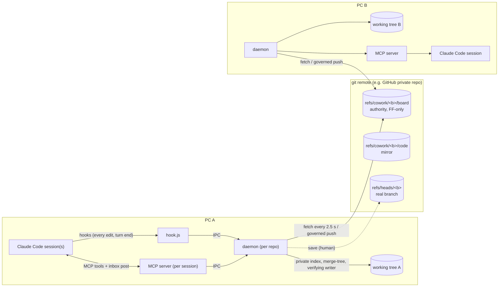

# cowork-sync — Design

**Date:** 2026-10-01 (revised 2026-10-02) · **Status:** **APPROVED by the user on 2026-10-02** ([glossary §27](../../spec/00-glossary.md#27-revision-24--user-review-answers-2026-10-02-and-spec-approval)); aligned with glossary rev 2.4 (spike-0 results in [§25](../../spec/00-glossary.md#25-revision-22--pass-2-owner-decisions-and-spike-0-results-01-github-02-claude-host-03-real-filter) and [§26](../../spec/00-glossary.md#26-revision-23--spike-04-windows-file-contention-and-spike-synthesis-decisions); the user's review answers, revised S1 and U3, in §27) · **Owner:** the project owner · **First users:** a pilot team · **Audience:** contributors and reviewers

cowork-sync is a Claude Code plugin that lets several developers, each on their own PC with their own Claude Code account, edit the **same files of one git repository at the same time**. Their Claude sessions coordinate like teammates: they see who is working where, avoid each other's regions, warn the one who collides, and hand leftover work to whoever owns the region. The only transport is the project's own git remote.

This document is the entry point. It explains the design and records the decisions. The normative detail lives in the chapters under [`docs/spec/`](../../spec/), starting with the binding glossary [`00-glossary.md`](../../spec/00-glossary.md). Where this overview and the glossary differ, the glossary wins.

---

## 1. Problem

A small team edits one codebase with Claude Code. Pushes and pulls collide constantly, so the team serialises: one person finishes, pushes, announces it, and the next person pulls. The team wants the experience of a shared spreadsheet: everyone works in the same files at once, and each person's Claude knows what the others are touching.

Analysis of a pilot team's repository showed most "tangles" came from generated files (a 2.6 MB generated docs tree, a CHANGELOG) rather than from real code overlap. cowork-sync handles those through configuration (`sync.exclude`, `merge.insertionMerge`). Its main purpose is the live co-editing itself.

## 2. Goals and non-goals

**Goals**
1. Edits by any team member (human or Claude) reach every other member's working tree automatically, without manual pull/push. A PC syncs while a Claude Code session is open in the repo, or during a human lease (`/cowork start --human <minutes>`, up to 8 h). Otherwise its daemon is idle ("idle (no session)"), and human edits made then are picked up when a session starts ([08-lifecycle](../../spec/08-lifecycle.md) LIF-41).
2. Each Claude session knows, before it edits, which regions teammates hold. It does not overwrite them. When a collision happens anyway, exactly one warning reaches the collider, and the agents resolve it by waiting, asking to go first, or handing off.
3. **Nothing is ever lost.** Every displaced or withheld version is preserved in a place the team can see and restore.
4. **Nothing fails silently.** Every pause, hold or degraded state is visible to the human and to the affected Claude.
5. Works on Windows, macOS and Linux, with any git host that accepts custom refs and keeps the repository private (public remotes are refused, SEC-12), distributed as a public plugin.

**Non-goals (v1)**
- Keystroke-level co-editing of one buffer (CRDT/OT). The unit of sharing is a saved file region, published at sensible boundaries.
- Any server other than the git remote.
- Exotic repository shapes: submodule edits, LFS-tracked edits, case-colliding paths, multiple live branches per clone. These are refused with a clear message.

## 3. Decisions

Twenty points are listed in [glossary §1](../../spec/00-glossary.md#1-user-decisions-binding), and the spec is written to them. All twenty are now decided by the user (U1–U12, S1–S8). In the review of 2026-10-02 ([glossary §27](../../spec/00-glossary.md#27-revision-24--user-review-answers-2026-10-02-and-spec-approval)) the user confirmed the S8 security default the design had added, the S5 *wake work set* (a woken turn edits only work it accepted or its own claims; other writes are PINned with guard `wake-scope`), the go-first grant pause (T-GRANT_PAUSE) and `/cowork start --fresh` with preview and confirm. The user answered the latency question with "must be faster", which revised S1 and U3 (§27.1, §27.2). The owner's technical decisions after review pass 2 and after spike 0 are recorded in [glossary §25.2](../../spec/00-glossary.md#252-owner-decisions-after-review-pass-2) and [§26.2](../../spec/00-glossary.md#262-decisions-on-the-synthesis-questions); the ones visible in this overview are cited where they apply. The ones that shape the architecture most:

| | Decision | Why it matters |
|---|---|---|
| U1 | Git remote is the only transport | No server to run. Access control is the repo's own permissions. |
| U3 | Team push governor, ≤ 12 attempts per 60 s (configurable 6–24 at genesis), automatic fallback to 6 for 30 min on any throttling signal (rev 2.4, glossary §27.2) | The budget sets the latency floor. GitHub's documented guidance is 6 pushes/min per repository; spike 0 measured 0 failures and no throttling at 12 and 24/min, so the user's "must be faster" raised the default to 12, with the fallback as the safety net (§12 risk 6). |
| U4 | Optimistic region claims | No waiting before an edit. Races inside the propagation window are decided by board order. |
| U5 / U6 | Deny + note + handoff; one canonical warning | Agents behave like polite teammates, and cost stays bounded. |
| S1 | Claude code is published at every **edit checkpoint** whose edit check passes (four structural checks, ≤ 0.5 s), and at turn end, green checkpoint or `cowork_checkpoint` (rev 2.4, glossary §27.1) | Half-done edits broke every teammate's build in experiments (a rename published without its call sites). The edit check publishes only states that parse and keep callers intact, so publishing after each edit stays safe; a failing check is silent and just waits for the next passing edit. |
| S5 | Sessions in auto mode are woken, and a woken turn may work, but only on its wake work set (work it accepted or its own claims). Writes outside that set, shell commands included, are PINned with guard `wake-scope` | Real-time negotiation, chosen over the more conservative default. |
| S7 | Relaxed adopt after save | Keeps `git status` honest, so nobody stashes and broadcasts a revert. |
| S8 | Settings, hooks and CI files never sync live (security default, confirmed by the user 2026-10-02, glossary §27) | A teammate's change to `.claude/`, `.github/workflows/` or `.gitattributes` could execute code on your PC. These move only through ordinary git commits. |

## 4. Architecture

**Components** (TypeScript, one esbuild bundle per entry point, Node ≥ 20, no runtime dependencies):

| Component | One per | Job | Chapter |
|---|---|---|---|
| daemon | user × clone | Snapshot, merge, apply, publish, fold the board, run the governor, own the hold registry and region tables | [01](../../spec/01-engine.md), [02](../../spec/02-protocol.md), [03](../../spec/03-data.md), [04](../../spec/04-regions.md), [05](../../spec/05-holds.md) |
| MCP server | Claude Code session | Claude's tools (`cowork_status`, `cowork_request`, …); posts doorbells into its own session's inbox socket | [06](../../spec/06-claude.md), [07](../../spec/07-coordination.md) |
| hook.js | hook invocation | Gate edits, attribute changes, inject context, close change-sets, record human evidence for `/cowork` verbs | [06](../../spec/06-claude.md) |
| cli.js | `/cowork` command | Human verbs: start, stop, save, status, resolve, … | [08](../../spec/08-lifecycle.md), [10](../../spec/10-product.md) |

The plugin spawns the daemon detached ([06-claude](../../spec/06-claude.md) CCI-51), so it outlives the `claude` process that started it. Spike 0 measured this on Windows for a spawn from the SessionStart hook (glossary §25 F4).

**Remote state.** One **board** ref per branch is the authority: a fast-forward-only chain whose commits carry operations (claims, requests, answers, hold records) and point, through their last parent, at the **live code commit** whose tree is the team's shared working tree. A second **code** ref mirrors the live code pointer for humans and tools. The real branch moves only when a human runs `save`. GitHub accepts every custom-ref primitive this needs, and an unfiltered `on: push` Actions workflow does not run for pushes to `refs/cowork/*` (measured, glossary §25 F8).

## 5. How it works

### 5.1 An edit, from keystroke to teammates

1. Claude in session A calls `Edit` on `serve.py` inside function `apply_step`.
2. **PreToolUse gate** (daemon side ≤ 15 ms p95; ≤ 100 ms p95 end to end on Windows, most of it the ≈ 40 ms it takes to start the hook process; glossary §26.2 item 4, §25 F6). The daemon maps the edit to its region, finds no foreign claim, and records a TENTATIVE claim. The edit proceeds. A **fence** stops the daemon from writing `serve.py` until PostToolUse, which closes the read-modify-write window. Claude's Edit applies whenever `old_string` matches the current content exactly once (Claude Code ≥ 2.1.208; measured again in spike 0, glossary §25 F7), so the fence is required.
3. **PostToolUse** confirms the change. The claim becomes publishable and joins this turn's **change-set** (CS). This is also an **edit checkpoint** (S1, glossary §27.1; a Bash/PowerShell transaction close is one too): the daemon worker runs the **edit check** on the CS's paths in `merge-tree --merge-base=A R TIP`, within ≤ 0.5 s on the 1.3 MB file, reusing the K7/T0 machinery. Four checks: no new parse errors; no breaking interface change whose callers are not updated in the same CS; no reference to a name the merged tree does not define; no label count above max(TIP, local) and no > 50 % shrink. **Pass** → the daemon captures a **ready pair** for the CS now (a later passing edit replaces it; the newest passing capture wins). **Fail** → no capture, no record, no message; the CS keeps its last passing capture, if any.
4. The claim rides the next governed push, so teammates see "A's Claude is editing `apply_step`" within seconds.
5. At **turn end** (Stop), or when a configured test command passes (green checkpoint), or when Claude calls `cowork_checkpoint`, the daemon also captures a **ready tree** for the CS, as before. A CS whose edit check is still failing at turn end becomes a K7 PIN, as before; an edit checkpoint is a structural checkpoint, not a timer, so half-done states that break callers are still never published.
6. The **governor** gives this peer a push window (5 s spacing team-wide, 1.5 s stagger, least-recently-written first; 10 s / 3 s in throttle fallback, glossary §27.2). The daemon builds `OUT = merge-tree --merge-base=A P TIP`, where P is MASK of the ready trees captured at edit checkpoints and change-set boundaries (glossary §3, §27.1), and runs **publish gate B1** on P: no hunk inside a foreign claim earlier in board order may leave. Edits made after the capture stay in the still-open CS and are not swept into this push. It pushes the board and the mirror as separate leased pushes; `--atomic` is not used in v1, because the board is the authority and the mirror may lag (glossary §26.2 item 1). A rejected push is classified by what the next fetch shows, never by the rejection text: the leased ref moved → lease loss, retry in the next window; the ref did not move and this peer's op ids are absent → transient, retry in the next window with backoff; three consecutive rejections of the same publish with the ref unchanged → `NONRETRYABLE` (the publish is PINned until a human runs `/cowork resume`) (glossary §26.2 item 2).
7. Every other daemon fetches every 2.5 s (never two fetches at once on one peer, glossary §25 F10), folds the new ops, merges incoming changes into its working tree through the **per-path verifying writer** (compare, then replace, never over a file that changed underneath), and coalesces applies to at most one per 10 s.

Human edits follow the same path while the PC is syncing (a Claude Code session open in the repo, or a `--human` lease; see §2). Their change-set closes after 20 s without edits on its paths, or on `/cowork done`.

**How the daemon touches your files** (glossary §26.1, measured on Windows in spike 04):
- **Reading.** The daemon never runs git on a user's working file. Git keeps a file memory-mapped while it hashes it, and an editor that saves in place during that window fails on Windows (W1). For each changed path the daemon does one short read, checks size and mtime before and after (re-reads once if they changed, otherwise skips the path this tick), copies the bytes to `<gitdir>/cowork/tmp/stage/<path>`, and hashes the copy with `--path=
` so attributes and filters still apply. This is one code path on every OS. A capture of an empty file is caught by the existing shrink guard (W2).
- **Snapshots write no objects.** Change detection hashes the staged copy without `-w`. Objects are written only for ready-tree captures, publishes, applies and hold records (W6), because writing a blob on every tick grew the object store by 205 MB in 20 min.
- **Writing.** The verifying writer's two-phase rename (target → `.old`, `.new` → target) is the only writer form; it worked 15/15 against a share-all reader where rename-over failed 15/15. A file that another program keeps open without sharing write access (as Excel does) defers as designed and becomes an INCOMING record after 60 s (W4). A file system without hard links falls back to a weaker copy writer; `/cowork start` warns and doctor shows it (glossary §26.2 item 7).

### 5.2 Collisions

| Kind | Example | What happens |
|---|---|---|
| **K1** visible claim | B's Claude tries to edit `apply_step` while A holds it | Denied with one message (T1) that names the holder, explains the options, and records the attempted edit as a SHADOW hold. B's Claude continues other work. At B's turn end the leftover is **offered** to A. When A's turn ends, A's Claude presents the request to A's human and asks "handle it?"; it accepts only on the human's word (a turn woken by a doorbell may accept on its own, S5). Accept → A's Claude does it. Decline or release → it **returns** to B. |
| **K3** race | Both claimed `apply_step` within the same few seconds | The later publisher's whole CS is PINned (kept on its PC, not shared). The **canonical warning** goes to the causer ("cowork-sync on behalf of A's session…"), and one notice goes to A. The causer waits, sends `cowork_request(go_first)` ("quick fix, ~2 min"), or hands off. |
| **K4** same lines, no claim overlap | Adjacent edits that git cannot merge | The earlier-published version goes on disk. The later version becomes a team-visible hold, restorable with one command (S2). |
| **K2 / K6** edit through a bypass | Claude edited a held region via Bash, or a human typed into it | Recorded and PINned. Never published into the foreign claim. |
| **K7** dependency | A's published rename would break B's unpublished caller | B's CS is held with the exact failing check (arity, import, parse, duplicate, > 50 % shrink). |

Exactly one daemon creates each event. Bystander Claudes are not woken; they see the situation in their digest at their next action.

### 5.3 Real-time negotiation

Each Claude Code session exposes a documented **inbox socket** (`CLAUDE_CODE_MESSAGING_SOCKET`). A message to an idle session starts a new turn (30–36 ms after posting, measured on Windows); a message to a busy session arrives after the current tool result, in the same turn (glossary §25 F2). cowork-sync's per-session MCP server, a true child of the session, posts **doorbells** into its own session only.
- **Wire format** (glossary §25 F1): an `auth` frame with the token, then `{"type":"user","message":{"role":"user","content":<text>}}`. Any other frame type is silently dropped, and the socket never replies. So a post counts as *sent* when the line is written and the server has not closed the connection within 100 ms, and it counts as *delivered* only when a UserPromptSubmit in that session carries the doorbell's nonce. Receipt messages back to the sender are v2.
- **Turn origin** (glossary §25 F2): a UserPromptSubmit whose prompt carries a cowork nonce (`cws-[0-9a-f]{16}`) is a doorbell, never a human prompt. It does not count as "the human was here", does not open a human-origin turn, and mid-turn it does not reset the change-set.
- **Who holds the token** (glossary §26.2 item 6): Claude Code puts `CLAUDE_CODE_MESSAGING_TOKEN` into every hook's environment and into the MCP server's. cowork code reads it only in the MCP server; it is never sent over IPC or written to disk, and the daemon never has it. A project stdio MCP server was measured to inherit the socket and token on Windows; for the plugin-packaged MCP server this is the first implementation-phase check, and a seat whose MCP server lacks the socket runs with wiring `HOOK_ONLY` (glossary §25 F3).
- Doorbells are capped per seat (≥ 10 min apart, ≤ 4/h) and per PC (≤ max(2, ⌊12 / max(1, |R ∪ {self}|)⌋)/h, where R is the ranked set of live non-ghost peers and this PC always counts itself; glossary §20), because every delivered message costs a Claude turn.
- Sessions in auto mode are woken too (S5). A turn started by a doorbell may edit code, but only for work it accepted or that targets its own claims. Every such change is attributed `origin=wake`, so the human sees what happened while away.
- Messages are framed as data, not instructions. Claude Code itself wraps them as a message from another session that the user did not type and that cannot grant permissions (measured, glossary §25 F2); cowork's own template keeps the same framing.

### 5.4 Save and adopt

`/cowork save "summary"` (human only) commits the exact tree of an existing live commit, never a synthesized one, onto the branch head. Every peer already has that tree on disk. Optional `checks.save` runs on candidates in a throwaway worktree. The live chain records the save as a base-move commit, so history is never rewritten (INV-FF).

"Human only" is checked with evidence from the UserPromptExpansion hook, which fires before the `!` line of a slash command runs. The hook loader records the `prompt_id`, command name and arguments, and the CLI accepts an acting verb only with matching evidence at most 60 s old (it waits up to 3 s). UserPromptSubmit cannot serve: spike 0 measured that it fires only after the `!` line has finished (glossary §25 F5).

After a save, each peer's local branch **follows automatically** when it is safe (S7):
- the saved content is fully applied;
- nothing is staged on the affected paths;
- no git operation is in progress.

Only `HEAD` and the affected index entries move; working-tree files are never touched. `git status` then shows exactly the edits made after the save. This matters because a dirty-looking `git status` invites `git stash`, which the sweep showed broadcasts a revert to the whole team.

### 5.5 Human git operations while live

The daemon watches `HEAD`, the stash, and in-progress markers (merge, rebase, cherry-pick, revert, bisect, sequencer). A change it did not cause enters `FREEZE(EPOCH)`. Applies and publishes stop, and a decision table decides what to do:
- a fast-forward pull is reconciled automatically;
- a commit containing teammates' unsaved changes is explained with the exact undo command;
- a stash or checkout requires `/cowork resume`.

A **mass-change breaker** and a **revert detector** hold suspicious bulk changes instead of publishing them. Examples: a formatter run, `/rewind`, or a stale editor buffer saving old content.

## 6. Latency and cost (what "live" means here)

| What | Typical | Basis |
|---|---|---|
| Teammates see a claim ("A is editing `f`") | p50 3–11 s | model, 4 peers |
| Claude code reaches teammates (every passing edit checkpoint; also turn end, green checkpoint, `cowork_checkpoint`) | ≈ 10–30 s after the edit = edit check (≤ 0.5 s) + one governor window + receiver fetch/apply. Edits whose check fails wait for the next passing edit or turn end. (Before rev 2.4, with turn-end/green publishing only: p50 30–36 s, Stop-only ≈ 3 min.) | model, glossary §27.1; measured in the soak |
| Human edits reach teammates (while a Claude Code session or `/cowork start --human` keeps the daemon alive) | 20 s quiet + one governor window (worst normal wait 9.5 s for 4 peers without collisions, plus ≈ 1.5 s push round trip; longer under contention, measured in the soak) + receiver apply coalescing (≤ 10 s; ≤ 2 min into files a mid-turn seat has read) | glossary §20, §27.2; push RTT measured (§25 F10) |
| One push / one fetch to GitHub (Seoul) | push p50 ≈ 1.8 s, p95 1.9–2.8 s; fetch of one explicit refspec p50 1.06–1.21 s, p95 1.43–1.57 s | measured, spike 01 (glossary §25 F10) |
| Push attempts | never more than 12 in any 60 s team-wide (sliding team guard, B = 12, G = 5 s, S = 1.5 s); on any throttling signal (HTTP 429, any 5xx, push RTT > 10 s, transient-rejection streak ≥ 2) automatically ≤ 6 (G = 10 s, S = 3 s) for 30 min, and other peers follow through a `health{throttle}` event | governor, glossary §27.2; 0 failures and no throttling measured at 6, 12 and 24/min (§25 F11) |
| Hook cost (PreToolUse edit gate and the other hooks) | gate: ≤ 100 ms p95 end to end on Windows (live repo), ≤ 80 ms p95 for the non-live fast path, daemon side ≤ 15 ms p95, each over ≥ 200 calls; measured so far: 62–66 ms end to end for a near-empty command hook (n = 5) | glossary §26.2 item 4, §25 F6 |
| Doorbell to an idle session | new turn starts 30–36 ms after the post | measured on Windows, `claude -p` (glossary §25 F2) |
| Daemon snapshot of the 1.3 MB file | p50 53 ms, p95 58 ms; daemon + git children ≈ 2.2 % of one core under 4 simulated editors (gate ≤ 2 %) | measured, spike 04 (glossary §26.1 W5) |
| Extra Claude input tokens | ≤ 15 % per active seat-hour at median context; idle seats 0 unless woken | cost model |

Latency is governed by the team push budget, not by cowork-sync's loop speed. Reads are cheap (≈ 1.6 fetches/s for 4 peers, about 11 % of the documented guidance). The spike-0 load test measured 0 failures and no throttling at 6, 12 and 24 pushes/min from one PC, and 10.4 % server rejections (no throttling text) at 48/min, where every failing push overlapped another push. After the user asked for faster Claude edits, the budget became 12 attempts per 60 s (U3, glossary §27.2): a team may set 6–24 in `.cowork/config.json` `host.pushBudgetPerMin`, which seeds `protocol.json` only at genesis, and any throttling signal drops the team to 6 for 30 min automatically. cowork pushes are serialized on one board ref, so they overlap less than the spike's pushes did. The rows marked "model" are still modelled: they need the real daemon and are measured by the soak (gates: ≤ B attempts in any 60 s window, zero HTTP 429, publish p95 ≤ 40 s, fallback engaged within one window of an injected throttle signal).

## 7. Safety model

1. **One hard boundary.** Publish gate B1 in the daemon never publishes a hunk inside a foreign claim earlier in board order. It re-runs after every lease re-merge (INV-FENCE). The PreToolUse gate is a courtesy that prevents wasted work. B1 is the guarantee.
2. **Fail closed** wherever cowork controls the outcome. Spike 0 measured that Claude Code lets the tool run when a command hook exits 1 or runs past its timeout, and blocks it only on exit 2 (glossary §25 F6). So the hook loader's top-level handler maps every internal failure to a deny (exit 2), and v1 uses command hooks for every hook. `mcp_tool` hooks fail open when their server is down; they are v2, for non-gating events only (glossary §25 F6). A daemon that does not answer denies edits in a live repo, with a message pointing to `/cowork doctor` and `/cowork pause` (S3). Host-level fail-open cases (Node missing, host hook timeout) are detected at SessionStart and by doctor, and they become `FREEZE(NOHOOKS)`.
3. **One hold registry.** Every difference between this PC and the team is a record in one append-only local ref, mirrored to the board unless it is `local_only`: secret-like files or scanner hits, failed filters, records that would include a quarantined or other non-LIVE path, and restore-marker companions. A `local_only` record leaves only a content-free stub on the board. Only LIVE paths ever enter a mirrored record (glossary §9). A record that is not yet mirrored is never auto-parked (glossary §25.2 item 1). There are no other stores, no hunk splicing and no automatic disk rewrites outside the verifying writer. A CI lint forbids the known-dangerous mechanisms.
4. **History is append-only.** The board and live code chains only fast-forward. A non-fast-forward tip is a rewrite incident: everything stops until a human runs `/cowork recover`. The lease that enforces this was measured atomic on GitHub: 100 of 100 simultaneous races had exactly one winner (glossary §25 F9).
5. **Secrets never leave.** Every cowork git call:
   - forces `filter.<d>.required=true` (measured on a pilot team's real filter: with it, every broken-filter case makes `git add` fail with the index unchanged; without it, the plaintext secret is stored silently; glossary §25 F12);
   - runs filters with the repository root as working directory, and keeps the PATH entries the configured filter drivers need;
   - pins `attr.tree` to the live base;
   - disables hooks and fsmonitor hooks.

   The start-time filter preflight runs in the real work tree and checks the round trip `cat-file --filters HEAD:p | hash-object --path=p --stdin` against `HEAD:p`; every disk comparison uses DISK_EQ (glossary §25 F12, §26.2 item 3). The earlier scratch-tree preflight never ran the filter and was replaced. New secret-like files and scanner hits stay `local_only`.
6. **Invariants are tested, not hoped for.** A deterministic multi-peer simulator on a local bare remote runs ≥ 10,000 seeded interleavings per night, with fault injection, against every invariant in glossary §21.

## 8. Scope of v1

**In:** everything in chapters 01–11, on GitHub, GitLab and Gitea, after the probe confirms custom refs and leases; Windows, macOS and Linux; Python, JS/TS and C# region detection with exact symbols, and every other text file by block.

**Refused with a clear message:**
- submodule or symlink changes, LFS-tracked edits;
- case-colliding paths and Windows-invalid names;
- hosts that reject custom refs, unless the fallback namespace is opted in;
- remotes readable without login (public repositories), and remotes whose privacy cannot be probed unless the human confirms with `--private-confirmed`; a repo that turns public while live freezes (`FREEZE CONFIG(public)`, SEC-12);
- git < 2.43, Node < 20, Claude Code < 2.1.270;
- a joining peer whose filter or EOL fingerprint differs from the team's.

**Deferred to v2:** [glossary §22](../../spec/00-glossary.md#22-deferred-to-v2-do-not-implement-do-not-reference-as-v1-behaviour). This covers 19 items (override, fork detection, cycle detection, archive and garbage collection, statusline chaining, sub-block claims, and others). Each one has a v1 replacement. Spike 0 added three v2 notes outside that table: doorbell receipt messages (glossary §25 F1), `mcp_tool` hooks for non-gating events (§25 F6), and `--atomic` board+mirror pushes where the host supports them (§26.2 item 1).

## 9. Spike 0 — results

Spike 0 ran on 2026-10-01 on one Windows 11 PC and one network, with Claude Code 2.1.270 in `claude -p` mode. The GitHub runs used a private sandbox repository, the filter test used a fresh clone of a pilot team's repository, and the contention test ran locally. The full report, with raw logs for every number, is [`spikes/RESULTS.md`](../../../spikes/RESULTS.md) (Korean: [`spikes/RESULTS.ko.md`](../../../spikes/RESULTS.ko.md)). The design changes it caused are in glossary [§25](../../spec/00-glossary.md#25-revision-22--pass-2-owner-decisions-and-spike-0-results-01-github-02-claude-host-03-real-filter) and [§26](../../spec/00-glossary.md#26-revision-23--spike-04-windows-file-contention-and-spike-synthesis-decisions); where RESULTS.md proposes something different, the glossary is the decision.

| # | Question | Result | Verdict | Design change |
|---|---|---|---|---|
| 1 | GitHub push tolerance | 0 failures and no throttling at 6, 12 and 24 pushes/min (4 workers, 36 min); 10.4 % `(failed)` / `commit_refs` rejections at 48/min, ref unchanged; Actions `on: push` made 0 runs for `refs/cowork/*` | Incomplete: one PC and one network | Budget stayed 6/min (§25 F11); raised to 12/min with automatic fallback to 6 by the user's review answer (rev 2.4, §27.2); rejections classified by outcome, 3 in a row → `NONRETRYABLE` (§26.2 item 2) |
| 2 | Two-PC lease race | 100/100 rounds with exactly one winner; 0 double wins; the loser's ref moved every round | Incomplete: two clones on one PC | Lease arbitration confirmed (§25 F9) |
| 3 | Inbox socket wire format and idle wake | Only the `user` frame is delivered; the old `message` frame is silently dropped; no reply; an idle session starts a turn in 30–36 ms; mid-turn messages arrive after the current tool result | Incomplete: Windows, `-p` mode only | Frame and sent/delivered rule (§25 F1); turn-origin rule (§25 F2) |
| 4 | MCP servers inherit socket and token | Yes for a project stdio MCP server on Windows; `CLAUDE_PLUGIN_DATA` is absent there | Incomplete: plugin MCP, macOS and Linux not run | Plugin MCP is the first implementation-phase check; `HOOK_ONLY` otherwise (§25 F3) |
| 5 | Detached daemon survives `claude` exit on Windows | Yes, when spawned from a SessionStart hook (heartbeats continued after exit) | Incomplete: normal exit only; closing the window, killing the tree, VS Code not run | Spawn pattern confirmed; doctor reports "daemon died with the host" (§25 F4) |
| 6 | Git Credential Manager refresh without prompts | Not done to the procedure. An overnight `ls-remote` watcher and 601 pushes with `GCM_INTERACTIVE=never` saw no prompt (supporting evidence only) | Not done | Needs a 24 h run and a forced sign-out (§26.3) |
| 7 | UserPromptSubmit before `!` preprocessing | No: it fires after the `!` line finishes. UserPromptExpansion fires before it | Fail, routed | Human evidence from UserPromptExpansion for all `/cowork` verbs (§25 F5) |
| 8 | A pilot team's real clean/smudge filter | Round trip and idempotency 21/21; `required=true` fails closed in every broken-filter case; the old preflight never ran the filter | Pass | Preflight replaced (§25 F12, §26.2 item 3) |
| 9 | Four-way contention on the 1.3 MB BOM+CRLF file | 11.4 failed editor saves per 1,000 with in-place `git add` (no-daemon control 4.2); with staged copies, 0 of 963 in-place saves failed; 205 MB of loose objects in 20 min | Fail, routed | Staged-copy reads on every OS, no objects on snapshot ticks (§26.1 W1, W6); item split into (i-a) daemon-attributable save failures, ≤ 1 per 1,000 with ≥ 3,000 saves per arm against a no-daemon control (W3), and (i-b) apply lag and RSS under the real daemon, which gates the first release, not the start of implementation (§26.2 item 5) |
| 10 | `mcp_tool` vs command hooks | Command hook 62–66 ms end to end (n = 5); `mcp_tool` 2–10 ms but fails open; exit 1 and timeout fail open, exit 2 blocks | Fail, routed (60 ms bound) | Command hooks for gating; one timing table: non-live ≤ 80 ms, live ≤ 100 ms, daemon ≤ 15 ms p95, measured over ≥ 200 calls (§25 F6, §26.2 item 4) |

**Count:** pass 1 (8) · fail, routed 3 (7, 9, 10) · incomplete 5 (1–5) · not done 1 (6). No result invalidates the core model: the lease is atomic on GitHub, the custom-ref namespace works and does not trigger Actions, `required=true` keeps secrets in, the private-index snapshot leaves the real index untouched, and exit 2 fails closed. The failures changed mechanisms (evidence hook, doorbell result, how files are read, the latency bound), not the design.

Other measured findings that changed the spec: the messaging token is in every hook's environment, not only the MCP server's (§26.2 item 6); GitHub supports `--atomic`, which v1 still does not use (§26.2 item 1); rename-over writing fails against any share-all reader, so two-phase is the only writer form (§26.1 W4).

**What is still open.** The user approved this spec on 2026-10-02 (glossary §27), so implementation of the simulator, test ports, lints and the core engine against a local bare remote may start now. The host-dependent parts (cross-network governor assumptions, AUTH pause and credential handling, human-verb evidence, doorbell wiring, daemon lifetime) wait for three runs that need the user (glossary §26.3):
- a second PC on a different network, for the cross-network lease race and fetch latency (items 1, 2);
- a 24 h unattended credential run followed by a forced sign-out (item 6);
- interactive runs in a terminal and in VS Code: `/cowork` typed 50 times, and the different ways of closing a session (items 3, 5, 7).

Optional: a macOS or Linux machine (otherwise seats on those OSes run `HOOK_ONLY` until measured), and a teammate's PC for the filter check.

## 10. Delivery shape

The spec was approved on 2026-10-02; the implementation plan will be written next (`writing-plans`). Its shape is fixed here:
1. **Phase 0 — Spike 0:** run on 2026-10-01 (§9); the three user-dependent runs of glossary §26.3 remain and gate the host-dependent parts only.
2. **Phase 1 — Kernel:**
   - the board/code refs and the loop (staged-copy snapshot → merge → verifying writer → governed publish), with the B = 12 governor and its throttle fallback (glossary §27.2);
   - the edit-checkpoint capture trigger (glossary §27.1); until the Phase 2 grammars land it runs as for an unsupported language (checks 1–3 pass trivially, check 4 applies);
   - the hold registry;
   - the PreToolUse gate and publish gate B1;
   - save and adopt;
   - the simulator with the core invariants.
3. **Phase 2 — Claims and regions:** tree-sitter WASM, interface checks (which also complete the edit check, ≤ 0.5 s on the 1.3 MB file), and the K1/K3/K4 flows with templates.
4. **Phase 3 — Real-time:** doorbells, negotiation, wake policy, and cost budget.
5. **Phase 4 — Productisation:**
   - doctor, notifications, i18n (6 languages), and README with the language switcher;
   - the marketplace release process;
   - the GitHub soak, including spike item (i-b), the loose-object growth gate (≤ 50 MB per busy peer-hour, glossary §26.1 W6) and the governor gates of glossary §27.2 (≤ B attempts in any 60 s window, zero HTTP 429, publish p95 ≤ 40 s, fallback within one window of an injected throttle signal).
6. **Phase 5 — Pilot-team trial** on a real repository, then the public release.

## 11. Chapters

| # | Chapter | Covers |
|---|---|---|
| 00 | [Glossary](../../spec/00-glossary.md) | Binding names, schemas, numbers, invariants, deferrals |
| 01 | [Engine](../../spec/01-engine.md) | Loop, snapshot, merge, verifying writer, publish, join, incidents |
| 02 | [Protocol](../../spec/02-protocol.md) | Board ops and fold, governor, ordering, liveness, convergence |
| 03 | [Data](../../spec/03-data.md) | Stored form, filters, conflict function, sync scope, portability |
| 04 | [Regions](../../spec/04-regions.md) | Region tables, claim identity, touch test, interface checks |
| 05 | [Holds](../../spec/05-holds.md) | Hold registry, change-sets, publication timing, escalation |
| 06 | [Claude integration](../../spec/06-claude.md) | Plugin layout, hooks, gate, fences, MCP, cost |
| 07 | [Coordination](../../spec/07-coordination.md) | K1–K7 flows, negotiation, doorbells, templates |
| 08 | [Lifecycle](../../spec/08-lifecycle.md) | Start, stop, save, adopt, human git operations, recovery |
| 09 | [Security](../../spec/09-security.md) | Git runner, secrets, IPC, execution surfaces, config |
| 10 | [Product](../../spec/10-product.md) | Commands, notifications, i18n, README, docs |
| 11 | [Testing and release](../../spec/11-testing.md) | Simulator, invariants, CI, soak, spike 0, release |

Research inputs: [`docs/research/`](../../research/). These are the primary-source research, the 205-finding failure sweep, and the consolidation (resolutions, catalogs, cross-check). Spike-0 evidence: [`spikes/`](../../../spikes/) (raw logs per spike, summarised in [`RESULTS.md`](../../../spikes/RESULTS.md)).

## 12. Known risks

1. **Volume of mechanism.** The design covers 205 failure modes. Duplicated definitions were the main data-loss risk, so the glossary fixes one definition per concept, and CI lints forbid the known-bad mechanisms.
2. **Hot-file lockout and contention.** One claim race on a 1.3 MB file can hold a PC's later work on that file until the holder answers. Spike 04 showed the Windows side of the same file: editors already fail some saves with no daemon running (a resident reader blocks atomic saves), and staged copies remove the failures the daemon caused (glossary §26.1 W1, W3). The soak must gate on "max per-path apply lag", "held bytes per hour" and daemon-attributable save failures.
3. **False-positive holds** from region tripwires on valid C# (`#if`, partials) or Python. Holds never lose data, but they stop collaboration. Measure the hold rate on a pilot team's repo.
4. **Host behaviour is measured on one PC only.** Spike 0 measured push tolerance, the lease, the inbox socket and hook latency on one Windows PC and one network. Behaviour across networks, credential refresh over 24 h, interactive sessions, and macOS/Linux are still unmeasured (§9, glossary §26.3).
5. **Cost of waking.** Waking sessions in auto mode, and letting woken turns work (S5), trades tokens for responsiveness. Caps and the per-seat budget bound it, and the cost soak measures it.
6. **Push budget above GitHub's guidance.** The default of 12 attempts per 60 s (U3, glossary §27.2) is twice GitHub's documented 6/min. Spike 0 saw no throttling at 12 and 24/min, but only from one PC and one network. The automatic fallback to 6 for 30 min on any throttling signal, the folded `health{throttle}` event that makes every peer follow, and the soak gate (zero HTTP 429) bound the risk; a team can also set 6 at genesis.
7. **Edit-check false passes or slow checks.** Publishing at each passing edit (S1, glossary §27.1) relies on four structural checks finishing in ≤ 0.5 s. A check that passes a broken state publishes it sooner than turn end would have; a check that runs slow delays the loop. Edit-check tests and the 1.3 MB timing budget gate it (11-testing).
